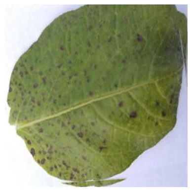
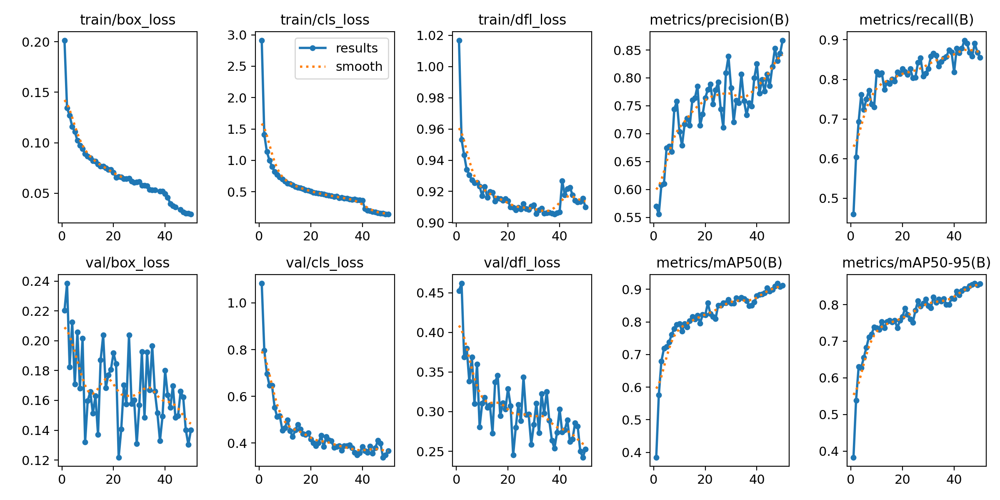
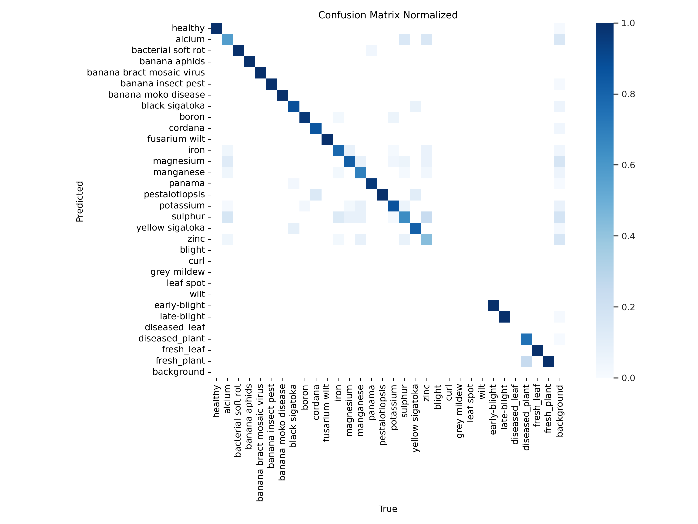
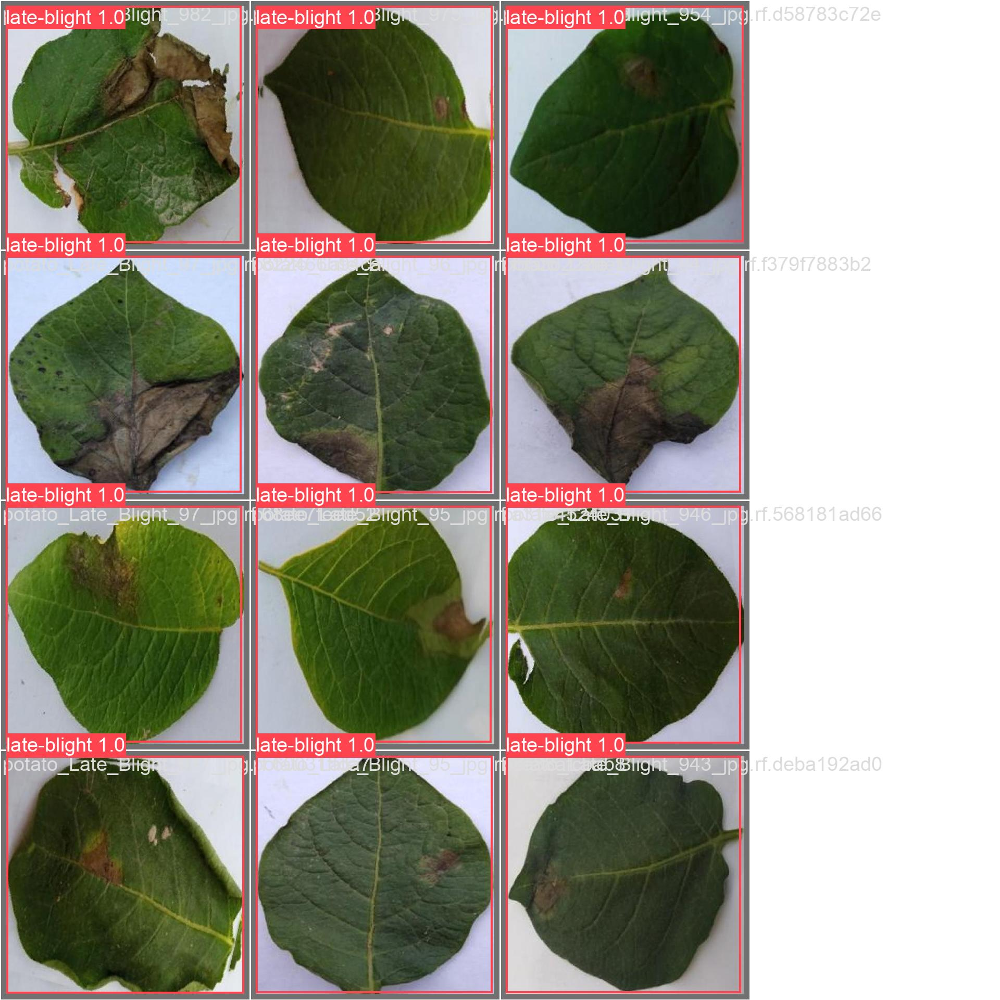

# Real-Time Crop Health Monitoring Using AI-Based Drone Surveillance and YOLOv12

Google Colab notebooks for detecting diseases in **potato, cotton and banana** crops with YOLO object detection, built as part of a Final Year Project in Computer Engineering and published in the *Pakistan Journal of Scientific Research* (2025).

[](https://doi.org/10.57041/zqb0ks20)

**Read the story behind the project:** [Eyes in the Sky, Brains on the Edge: Detecting Crop Disease with Drones, YOLOv12 and Raspberry Pi](https://medium.com/@aimanlatif308/eyes-in-the-sky-brains-on-the-edge-detecting-crop-disease-with-drones-yolov12-and-raspberry-pi-44a95925e01b)

---

## Overview

Traditional crop disease identification depends on manual inspection, which is slow, labour-intensive and hard to scale. This project explores an AI-based alternative:

- Train YOLO detection models on crop-disease images
- Combine three crops into one **28-class** merged model
- Evaluate with precision, recall, mAP50 and mAP50-95
- Connect the approach to a **drone + Raspberry Pi** edge-computing setup



## Results

All values are from the validation runs in the notebooks (mAP@0.5).

| Crop / model | Model | Precision | Recall | mAP50 |
|---|---|---|---|---|
| Potato | YOLOv12n | 1.000 | 0.998 | **0.995** |
| Cotton | YOLOv12n | 0.876 | 0.776 | **0.832** |
| Banana | YOLOv8n (baseline) | 0.829 | 0.857 | **0.891** |
| Merged (28 classes) | YOLOv12n | 0.834 | 0.888 | **0.919** |

The merged model also reached **mAP50-95 of 0.858**. YOLOv12-Nano has about **2.57M parameters and 6.5 GFLOPs**, and ran at about **5.9 ms per image** on a Tesla T4 GPU in the Colab validation run.



### Where the model struggles

Many classes scored around 0.995 mAP50 (healthy, Fusarium wilt, banana aphids, bract mosaic virus, banana moko disease). The weakest classes were mostly subtle nutrient deficiencies: sulphur (0.61), zinc (0.70), calcium (0.69) and manganese (0.76). Grey mildew in cotton (0.60) was also difficult. These classes show where more data is needed.



### Sample predictions



## Repository structure

```
.
.
├── README.md
├── notebooks/
│   ├── 01_yolov12_potato.ipynb
│   ├── 02_yolov12_cotton.ipynb
│   ├── 03_yolov8_banana.ipynb
│   └── 04_yolov12_merged_28_classes.ipynb
└── results/          # training curves, confusion matrix, predictions
```

## Quick start

The notebooks are designed for **Google Colab** with a GPU runtime (a Tesla T4 was used).

1. Open a notebook from the `notebooks/` folder in Google Colab.
2. Set the runtime to GPU (Runtime → Change runtime type).
3. Install YOLOv12 from the authors' repository:

```python
!pip install -q git+https://github.com/sunsmarterjie/yolov12.git
!pip install roboflow supervision flash-attn albumentations
!pip install --upgrade ultralytics
!wget https://github.com/sunsmarterjie/yolov12/releases/download/v1.0/yolov12n.pt
```

4. Point `data.yaml` to your dataset and train:

```python
!yolo task=detect mode=train model=yolov12n.pt data=data.yaml epochs=50 imgsz=640 batch=6 device=0 plots=True amp=True save=True save_period=1
```

5. Validate the best checkpoint:

```python
!yolo task=detect mode=val model=runs/detect/train6/weights/best.pt data=data.yaml
```

6. Run inference on an image:

```python
from ultralytics import YOLO

model = YOLO("runs/detect/train6/weights/best.pt")
results = model.predict("path/to/image.jpg", conf=0.4, iou=0.3)
```

## Training setup

| Setting | Value |
|---|---|
| Base weights | `yolov12n.pt` (YOLOv12-Nano) |
| Epochs | 50 |
| Image size | 640 × 640 |
| Batch size | 6 (merged), 8 (cotton, potato) |
| Augmentation | Mosaic, MixUp, random flip, colour jitter (Ultralytics defaults) |
| Hardware | Google Colab, Tesla T4 |

## Datasets

Datasets were assembled and annotated on [Roboflow](https://roboflow.com) and exported in YOLO format. They are **not included** in this repository.

- **Cotton:** 6 classes (blight, curl, grey mildew, healthy, leaf spot, wilt)
- **Potato:** 3 classes (healthy, early blight, late blight)
- **Banana:** nutrient deficiencies, viral and fungal diseases, pests and healthy plants
- **Merged:** all of the above, 28 classes

Add your own dataset links here: Dataset links are available on request

## Notes

- The banana notebook uses **YOLOv8n** as a baseline. The potato, cotton and merged notebooks use **YOLOv12n**.
- The paper reports an inference time of about 4.2 ms per image and potential pesticide-use reductions of 30–45% in trial implementations. Those figures come from the paper. The notebooks in this repository do not measure them.

## Citation

Sargana, H., Latif, A., Boota, A., Aqeel, M., Sohaib, A., & Iqbal, M. (2025). Real-Time Crop Health Monitoring Using AI-Based Drone Surveillance and YOLOv12. *Pakistan Journal of Scientific Research*, 5(1), 29–38. https://doi.org/10.57041/zqb0ks20

```bibtex
@article{sargana2025crop,
  title   = {Real-Time Crop Health Monitoring Using AI-Based Drone Surveillance and YOLOv12},
  author  = {Sargana, Hussain and Latif, Aiman and Boota, Arshan and Aqeel, Muhammad and Sohaib, Ahmed and Iqbal, Muhammad},
  journal = {Pakistan Journal of Scientific Research},
  volume  = {5},
  number  = {1},
  pages   = {29--38},
  year    = {2025},
  doi     = {10.57041/zqb0ks20}
}
```

## Acknowledgements

Thanks to co-authors Aiman Latif, Arshan Boota, Muhammad Aqeel and Ahmed Sohaib, and to Muhammad Iqbal at NUST Islamabad. Research carried out at the Advance Image Processing Research Lab (AIPRL), Khwaja Fareed University of Engineering and Information Technology, Rahim Yar Khan, Pakistan.

Built on [YOLOv12](https://github.com/sunsmarterjie/yolov12) and [Ultralytics](https://github.com/ultralytics/ultralytics).

## License

**[ADD A LICENSE, e.g. MIT, or remove this section]**
